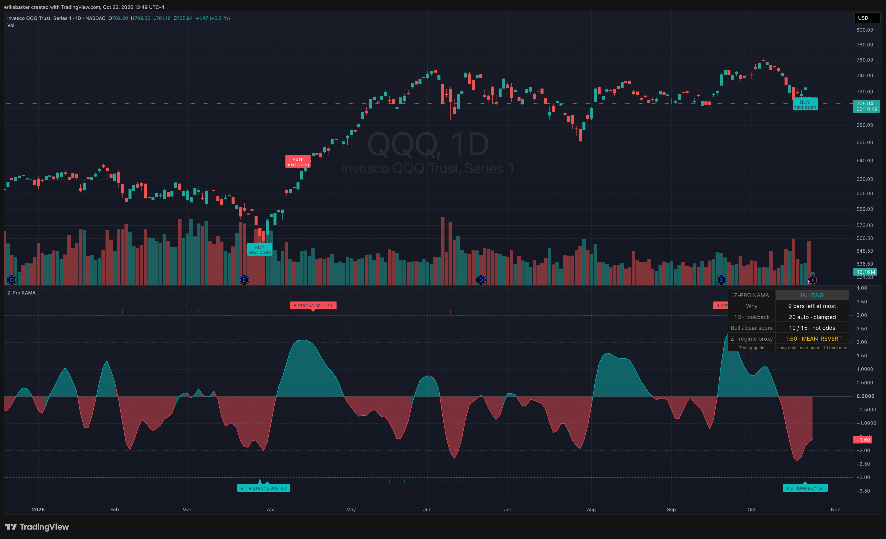

# Z-Score Probability Pro KAMA

**An adaptive residual Z-score for market-direction research.** Pine Script for TradingView, a Python reference implementation, and a small next-open backtest ledger by [Erika Barker](https://erikabarker.ai/).

[](https://github.com/erikabarker/zscore-pro-kama/actions/workflows/checks.yml)
[](LICENSE)
[](pyproject.toml)

[TradingView indicator](https://www.tradingview.com/script/PggSrcTj-Z-Score-Probability-Pro-KAMA/) · [The article and research journey](https://erikabarker.ai/data-analysis/z-score-indicator-lessons/) · [Python API](docs/api.md) · [Research evidence](docs/research.md) · [Agent instructions](AGENTS.md)


*Actual TradingView interface, captured October 23, 2026. The current daily bar was unfinished. This is an interface illustration, not an independently verified performance record.*

## What it measures

The indicator measures how unusual the current **price-minus-KAMA residual** is relative to its recent distribution. It centers that residual, divides by its population standard deviation, and smooths the resulting Z-score with a nine-bar ALMA. A separate agreement score combines reversals, confirmed divergence, baseline slope, a variance-ratio regime proxy, completed higher-timeframe context and volume.

The legacy word **“Probability” is a name, not a statistical claim**. A score of 65 means weighted rule agreement; it does not mean a 65% chance of profit. A ±2 reading on the smoothed oscillator is not a calibrated Gaussian tail probability or a guarantee of reversal.

The TradingView version adapts its lookback to chart duration without manual changes. That adaptation is a bounded calendar-duration heuristic, not an optimizer and not evidence that settings are optimal for every market. [Read the formulas and timing rules.](docs/methodology.md)

## Run it

Requires Python 3.11–3.13 and [uv](https://docs.astral.sh/uv/).

```bash
git clone https://github.com/erikabarker/zscore-pro-kama.git
cd zscore-pro-kama
uv sync --locked
uv run python examples/research_demo.py
uv run pytest -q
```

The example runs entirely offline with explicitly synthetic prices. It demonstrates data → features → confirmed signals → next-open fills → cost-adjusted trade records. It is not market-performance evidence.

For your own research:

```python
from zscore_kama import signals, simulate

# bars and higher are completed OHLCV DataFrames with UTC open/end times.
# Supply higher bars using your data provider's actual aggregation boundaries.
features = signals(bars, higher)
result = simulate(bars, features, commission_bps=5, slippage_bps=5)
print(result.trades)
print(result.open_entry, result.pending_buy, result.pending_exit)
```

[The API guide](docs/api.md) defines the input schema and includes a CSV-loading example. The Python package implements the **default classical KAMA/ALMA profile**, including regular divergence and the default score. Other Pine baseline choices, MAD mode, hidden divergence and display settings are not ported. Numerical parity with TradingView has **not** been established. Daily QQQ/JPM motivated the research; intraday and other assets require independent validation.

## Choose an entry point

| Use | Start here |
|---|---|
| View market context in TradingView | [Published indicator](https://www.tradingview.com/script/PggSrcTj-Z-Score-Probability-Pro-KAMA/) or [`pine/indicator.pine`](pine/indicator.pine) |
| Inspect a native simulated strategy | [`pine/strategy.pine`](pine/strategy.pine), then set explicit costs in Strategy Properties |
| Add features to a research pipeline | [`signals()`](docs/api.md), without coupling features to execution |
| Evaluate one entry/exit policy | [`simulate()`](docs/api.md#trade-ledger), next-open long-only trades |
| Integrate through a coding agent | [`AGENTS.md`](AGENTS.md) and the [integration guide](docs/integration.md) |
| Assess the evidence | [Research report and limitations](docs/research.md) |

## Evidence, without the sales pitch

An earlier retrospective QQQ/JPM daily study produced 73 chronological test opportunities from 2010–October 2026. With 5 bps commission and 5 bps adverse slippage **per side**, the pooled completed-trade win rate was 67.1%. Its 95% year-block interval for mean net return included zero. Symbols and rules had already been examined; this was **not a pristine unseen test**. The tested allocation did not outperform SPY buy-and-hold. Small ML filters did not demonstrate a reliable incremental advantage.

Those are archived research results from an earlier implementation, not a fresh backtest of this package and not a forecast. [The report](docs/research.md) explains the sample, cost assumptions, benchmarks, numerical-parity gap and reproduction limits. The release's automated checks verify implementation behavior; they do not establish alpha.

## Development

```bash
uv run pytest -q
uv run ruff check .
uv run ruff format --check .
uv run mypy
uv build
```

`just check` runs these checks plus the offline example. CI exercises Python 3.11, 3.12 and 3.13. Core dependencies are NumPy and pandas; neither credentials nor a market-data subscription are needed to run the example or tests. There is no broker connection, order submission, telemetry or automatic parameter search.

## Attribution and reuse

The earlier [HMA Z-score project](https://github.com/erikabarker/Z-score-Probability-Indicator-with-Hull-Moving-Average-for-Trading-View) credits SteverSteves's original work. This repository preserves that lineage while presenting Erika Barker's KAMA version and research implementation. KAMA, HMA, ALMA, Z-scores and divergence are established methods; originality is not claimed for those building blocks. See [NOTICE](NOTICE) for sources and scope.

Released under [MPL-2.0](LICENSE). Retain attribution and applicable notices when reusing the code. TradingView republication also has its own platform rules. [CITATION.cff](CITATION.cff) provides citation metadata. Questions and reproducible findings are welcome through [issues](https://github.com/erikabarker/zscore-pro-kama/issues); see [CONTRIBUTING.md](CONTRIBUTING.md).
